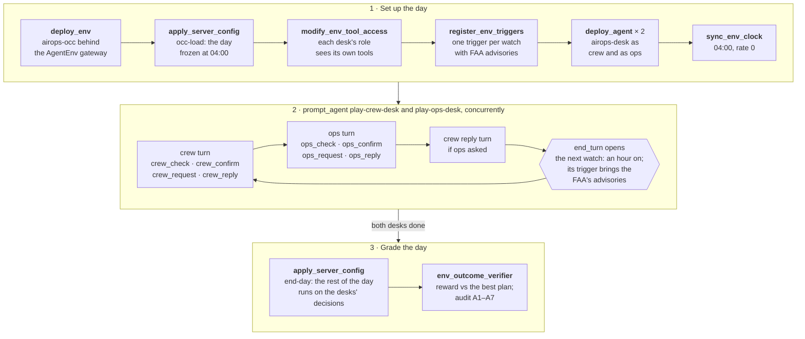
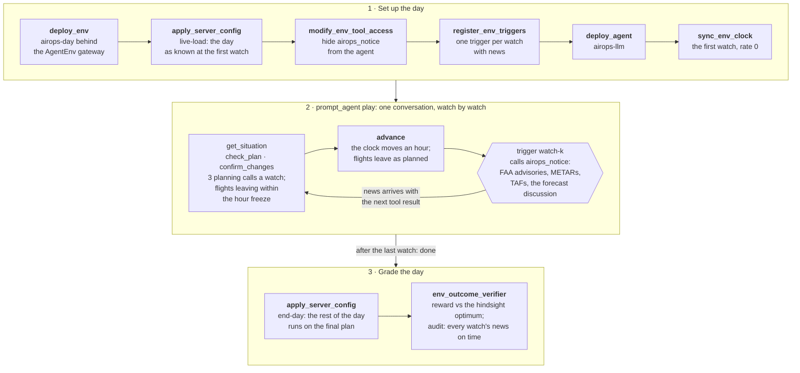

<div align="center">

<a href="https://huggingface.co/spaces/earakely-scale/AirOpsEnv-AgentEnv?episode=https://huggingface.co/datasets/earakely-scale/AirOpsEnv-AgentEnv/resolve/v0.3.3/viewer/episodes/occ-board-sol-joint.openai-gpt-6.1-sol.b6-20240713-0400.json&t=362&view=room&play=1&speed=2"></a>

<h1>AirOpsEnv v2: the ops control center</h1>

<h3>Run an airline's whole network through a real storm day, from the two desks of its control center</h3>

<p>An AgentEnv environment built from public U.S. flight, FAA and crew-rule records, graded with no judge against the best plan of aircraft and crews found in hindsight, next to its proven bound.</p>

<a href="https://huggingface.co/spaces/earakely-scale/AirOpsEnv-AgentEnv"></a>
<a href="https://huggingface.co/datasets/earakely-scale/AirOpsEnv-AgentEnv"></a>
<a href="https://github.com/earakely-scale/agentenv-airops-plugin"></a>
<a href="https://www.agentenvframework.com"></a>

</div>

---

AI agents run JetBlue's operations control center through a real storm day, split between two desks the way airline
control centers split the work. The **ops controller** runs the flights and aircraft with the FAA: it cancels flights
and round trips, holds them, and claims and swaps arrival slots in the FAA's ground delay programs. The **crew
scheduler** runs the pilots and flight attendants: it calls reserves, swaps crews between trips, deadheads them as
passengers and rests them in hotels, with pilots under FAR 117 and flight attendants under 14 CFR 121.467. Neither can
do the other's job, so they talk, through typed requests the other desk accepts or declines (hold this flight, cancel
that round trip, cover this one) and free text. The day is a real one: one of 24 storm dates at JFK or Boston from
2022 to 2026, the whole network from 04:00, about 700 flights, 220 aircraft and 900 crews and reserves, with the FAA
Command Center's ground stops and ground delay programs arriving as they were issued. It plays out on AgentEnv's
virtual clock, watch by watch, and is graded once, on the day as it really happened, with no judge: against the best
plan of aircraft and crews together that a solver found knowing the whole day, next to the lower bound it proved.
Every recorded run replays exactly through the env and passes its audit, and replays in 3D in the Space: the
control-center room where the desks decide, and the airport where it plays out.

<p align="center">
  <a href="https://huggingface.co/spaces/earakely-scale/AirOpsEnv-AgentEnv?episode=https://huggingface.co/datasets/earakely-scale/AirOpsEnv-AgentEnv/resolve/v0.3.3/viewer/episodes/occ-board-sol-joint.openai-gpt-6.1-sol.b6-20240713-0400.json&t=362&view=room&play=1&speed=2"></a>
</p>
<p align="center"><sub>Two GPT-6.1 Sol desks run JetBlue's network through the Boston storm of Saturday 13 July 2024
(<code>b6-20240713-0400</code>): 612 flights on 193 aircraft from 04:00, an FAA ground stop and a ground delay program
at Logan in the afternoon. The crew scheduler makes 34 crew moves (24 assignments, 5 deadheads, 2 swaps, a reserve
call and 2 releases); the ops controller cancels 7 flights and holds 3; between them pass 15 messages, a HOLD the ops
desk accepts and three COVER requests, two of them accepted. Flown on what really happened, the day costs 13.4% more
than the best plan found in hindsight and saves 86% of what standard crew-desk practice leaves on the table: reward
0.806, against 0.657 for one Sol agent running both desks and 0.308 for the standard crew desk. In the clip the crew
desk's HOLD of B6 515 to Buffalo is accepted in the room and B6 515 pushes back held until 07:45; later B6 451's crew
walks up to gate C23 and it takes off. Click it to replay the day in 3D, from the room at 06:02; the
<a href="https://github.com/earakely-scale/agentenv-airops-plugin/releases/tag/v0.3.0">full film</a> and two more,
Boston in fog and rain on 10 December 2023 and in snow on 11 January 2025, are on the v0.3.0 release.
Airport © OpenStreetMap contributors (ODbL), imagery USGS The National Map; flights BTS; advisories FAA ATCSCC;
radar NEXRAD via the Iowa Environmental Mesonet. The control-center room, the crew room, the crews' paths and the
walk-rounds are drawn for display only.</sub></p>

**Contents:** [The control center](#the-control-center) · [How a day is played](#how-a-day-is-played) ·
[The days](#the-days) · [Grading](#grading) · [The Sol board](#the-sol-board) · [Watch a run](#watch-a-run) ·
[Run it](#run-it) · [How it was validated](#how-it-was-validated) ·
[The dataset and the Space](#the-dataset-and-the-space) · [AirOpsEnv v1](#airopsenv-v1-one-desk-at-one-hub) ·
[Repository](#repository) · [Licence and attribution](#licence-and-attribution)

## The control center

|  | Ops controller | Crew scheduler |
|---|---|---|
| **Sees** | the network as projected now on what is known: every flight, the aircraft, the FAA's programs and slots, the cost; each flight's crew status from the crew system (legal, times out at HH:MM, waits for its crew until HH:MM, no crew) | the same picture, plus every crew: its trip, duty clock and rest, the reserves at each base, the hotels; the crew system's own alerts |
| **Does** | cancel, cancel a round trip, hold to a time, claim an FAA slot, swap two flights' slots, release a hold or claim | assign a crew to a flight, call a short-call reserve, swap two crews' remaining trips at a station, deadhead a crew, rest a crew in a hotel, release a crew it moved |
| **Asks the other desk** | COVER (crew this flight by a time), TEXT | HOLD (a flight until its crew is ready), CANCEL, CANCEL_PAIR (a round trip), TEXT |
| **Can't** | move or assign crews | cancel or hold flights |

- **The channel is part of the env.** A request is a tool call; the env logs it with its sim time, its answer and the
  actions that followed, and carries out an accepted HOLD or CANCEL as the ops desk's decision. A request lapses when
  its flight leaves, is cancelled or its time passes; a newer one on the same flight replaces it.
- **Turns.** Each hourly watch, from 04:00 until the last flight's deadline, the crew desk takes its turn, then ops,
  then the crew desk again if ops asked it something. A turn opens on the desk's page (the day as projected now, about
  6,000 characters) and ends with `end_turn`, whose result is the next page. The env runs the turns, so every run
  replays exactly.
- **The crew system** crews every flight the crew desk leaves alone, by standard practice (its own crew, else a
  reserve, a swap, a deadhead or the 2 h pilot extension), and can't cancel: where it is stuck it tells the crew desk,
  and the flight waits for a crew or its deadline. Aircraft swaps happen on their own: aircraft of one type at a
  station are interchangeable.
- **What the desks know.** A flight's own delay becomes known 2 hours before its scheduled departure; FAA advisories
  arrive as issued, and the FAA's CDM refuses a slot claim outside the program's pool. A hold can start no earlier
  than the freeze line, an hour ahead, and flights due out before it are committed.
- **One agent** (mode `one`) runs both desks from one page and both tool sets, with no channel: the same day, the same
  grading, for comparison.

| Desk | Tools |
|---|---|
| ops | `ops_flights`, `ops_program`, `ops_aircraft`, `ops_check`, `ops_confirm`, `ops_request`, `ops_reply` |
| crew | `crew_flights`, `crew_crews`, `crew_reserves`, `crew_program`, `crew_options`, `crew_check`, `crew_confirm`, `crew_request`, `crew_reply` |
| both | `end_turn`, `wait_turn`, `resign`; a `*_check` tries changes on the projected day without committing them, a `*_confirm` commits them |

Each desk is its own A2A agent (`airops-desk`, in role `ops`, `crew` or `both`) and sees only its role's tools on the
AgentEnv gateway. The harness plays a model on Anthropic Messages, OpenAI Responses or OpenAI-compatible chat, under a
cost cap per desk, or a fixed script with no model.

## How a day is played

<details open>
<summary><b>The task's steps</b>, and the turns inside <code>play</code></summary>



</details>

The audit scores a run only if every watch's news arrived on time (A1), every call was made in its desk's turn (A2),
no decision reached back before its minute (A3), each desk kept to its role (A4), every flight flew with a legal crew
(A5), the day's cost is not under the proven bound (A6), and both desks were present to the end, or stood down (A7).

## The days

The pack `b6-v2` is 70 of JetBlue's real days, each its whole network from 04:00 Eastern:

| Split | Dates | What |
|---|---:|---|
| eval | 24 | storm dates, drawn 12 per storm hub (8 summer and 4 winter each), every one from its own storm event |
| train | 44 | storm dates of events with no eval date, so no storm is in both |
| control | 2 | calm days: 2024-07-03 and 2025-01-15, no FAA program at JFK, Boston, Newark or LaGuardia |

`drawn_for` in `v2_tasks` is the hub a date was drawn for, `hub` the airport the viewer shows; a date can be a storm
date at both. An eval date has a median of 696 flights (494 to 774) on 218 aircraft to some 85 airports, flown by 364
pilot crews and 356 cabin crews on generated trips, with 82 pilot and about 100 cabin reserves at the bases. A storm
date is one where the FAA's programs at JFK or Boston controlled or held at least 5 JetBlue flights, from 19 summer and
winter months between December 2022 and July 2026.

- **Real, as recorded.** Every JetBlue flight and tail from the BTS on-time records, with its scheduled times, its own
  delay and block time; aircraft types and seats from Form 41; where each aircraft really was at 04:00; the FAA Command
  Center's ground stops and ground delay programs at JFK and Boston as issued, and as they ran; other carriers'
  flights at the two hubs; the rules (FAR 117's Tables A and B, the 2 h extension and 10 h rest; 121.467's 14 h
  scheduled duty and 10 h rest; 121.391's cabin minimums); the crew bases by date; the costs (the FAA's rates for
  aircraft and pilot time, BLS wages for flight attendants, GSA hotel rates, JetBlue's average fare for a deadhead
  seat).
- **Modelled.** The FAA's slots: arrival slots shared out by schedule over every carrier's arrivals plus an unseen
  stream, with EDCTs, compression and ground-stop holds. The crews: JetBlue's pairings are not public, so a
  cost-optimizing builder generates trips from the published schedule, separately for pilots and flight attendants,
  and reserves are set at the middle of a sourced industry band.
- **Not modelled, and labelled as such:** union contract rules, multi-day limits (crews start the day rested),
  passengers' connections and rebooking, maintenance, dispatch, gates, and other airlines as actors.

[FIDELITY.md](FIDELITY.md) says what is real data, what is modelled and how each layer was checked against the record,
with every miss.

## Grading

The day's cost, in passenger-minutes: each passenger's arrival delay; each cancelled passenger (523, more when the
cancellation comes under 2 hours before departure); the FAA's rates for aircraft time on the ground and in the air,
and tonight's ferries; crew deadheads (pay and the seats they take), hotels away from base, and crews left out of
place for tomorrow's trips.

| Reference | What it is |
|---|---|
| best plan | the cheapest day of aircraft and crews together a solver found knowing the whole day, replayed exactly with a legal crew on every flight; it scores 1.0 |
| bound | a proven lower bound on any day's cost; the gap between them is published per date (eval dates 2.4% to 13.9%, median 5.1%) |
| B0 | standard crew-desk practice with the aircraft doing nothing: each flight's planned crew, else the cheapest of a reserve, a swap, a deadhead or the 2 h pilot extension, cancelling only when no legal crew can arrive in time; it scores 0.308 |

The reward is 0.2 + 0.8 exp(−g/0.5), with g = max(0, cost − best) / max(B0 − best, 0.1 best): 1.0 at the best plan,
0.308 at B0, and never below 0.2. `reward_L` is the same against the bound, a lower reading where the best plan is
weak. The avoidable share is the part of B0's excess over the best plan a run saved. Since no aircraft-and-crew
optimum can be proven at this size, a run can come in under the best plan; it then scores 1.0 and is flagged.

## The Sol board

GPT-6.1 Sol (`openai/gpt-6.1-sol`, reasoning effort high) on the 24 eval dates, once in each mode, pre-registered
before the first run: the code, the pack's hash, the dates, their order, the caps and the budget. Every run scored,
replays exactly through the env's calls and passes the audit, and an independent recheck recomputed every reward from
the graded costs.

| Mode | Mean reward (95% CI) | reward_L (95% CI) | Over the best plan, median | Avoidable cost saved, median | Spend |
|---|---|---|---:|---:|---:|
| **Two desks**, talking | **0.598** (0.545–0.658) | 0.523 (0.484–0.564) | 12.3% | 60% | $48.33 |
| **One agent** at both desks | **0.550** (0.497–0.609) | 0.487 (0.450–0.526) | 13.8% | 57% | $24.54 |
| Standard crew desk (B0) | 0.308 | | | 0% | |

- **Two desks against one agent, paired by date:** +0.049 reward (95% CI 0.024–0.075), two desks higher on 18 of 24
  dates; their days cost 2.9% of the best plan less (CI 1.4–4.6%).
- **Both far above standard practice, both far from the best plan:** at the median a Sol day saves about 60% of what
  B0 leaves on the table and costs 12 to 14% more than the best plan. There is room to grow.
- CIs are bootstrap over the 24 dates (10,000 resamples). Spend is the harness's tokens times price; the whole board
  cost $73.94 with a superseded attempt, the pilot before it $6.88.

<details>
<summary><b>Per date</b>: each run's reward and reward_L, and how far over the best plan it came</summary>

| Date | Storm hubs | Flights | Under FAA programs | JetBlue cancelled | Gap, best to bound | Two desks | One agent | Two desks, reward_L | One agent, reward_L |
|---|---|---:|---:|---:|---:|---:|---:|---:|---:|
| 2022-12-07 | JFK, BOS | 767 | 32 | 6 | 4.7% | **0.465** | 0.408 | 0.426 | 0.385 |
| 2023-06-06 | BOS | 774 | 5 | 2 | 5.8% | **0.710** | 0.595 | 0.525 | 0.471 |
| 2023-06-16 | JFK, BOS | 753 | 31 | 47 | 5.7% | **0.576** | 0.510 | 0.518 | 0.469 |
| 2023-07-08 | JFK, BOS | 693 | 27 | 26 | 4.7% | **0.594** | 0.495 | 0.556 | 0.472 |
| 2023-07-09 | JFK, BOS | 733 | 87 | 211 | 4.4% | 0.471 | **0.482** | 0.453 | 0.463 |
| 2023-07-13 | JFK, BOS | 750 | 12 | 15 | 13.8% | **1.000** \* | 0.967 | 0.578 | 0.537 |
| 2023-07-29 | JFK, BOS | 698 | 73 | 70 | 5.8% | **0.569** | 0.548 | 0.520 | 0.504 |
| 2023-12-10 | JFK, BOS | 665 | 44 | 0 | 4.7% | **0.754** | 0.579 | 0.676 | 0.537 |
| 2023-12-18 | BOS | 752 | 48 | 41 | 5.2% | **0.412** | 0.356 | 0.397 | 0.350 |
| 2024-06-23 | JFK, BOS | 662 | 112 | 57 | 4.6% | **0.477** | 0.402 | 0.445 | 0.386 |
| 2024-07-13 | BOS | 612 | 8 | 10 | 12.2% | **0.806** | 0.657 | 0.699 | 0.589 |
| 2024-07-15 | JFK, BOS | 664 | 15 | 12 | 8.3% | **0.484** | 0.462 | 0.410 | 0.399 |
| 2024-07-22 | JFK | 668 | 33 | 21 | 8.5% | **0.545** | 0.438 | 0.462 | 0.397 |
| 2025-01-11 | BOS | 494 | 20 | 6 | 5.4% | 0.805 | **0.819** | 0.740 | 0.751 |
| 2025-07-08 | JFK, BOS | 637 | 71 | 43 | 4.4% | 0.601 | **0.652** | 0.550 | 0.589 |
| 2025-07-12 | JFK | 647 | 17 | 23 | 4.1% | 0.528 | **0.542** | 0.479 | 0.489 |
| 2025-12-02 | BOS | 619 | 18 | 0 | 5.7% | **0.466** | 0.345 | 0.398 | 0.332 |
| 2025-12-14 | JFK | 667 | 41 | 89 | 3.2% | **0.530** | 0.427 | 0.509 | 0.417 |
| 2025-12-19 | JFK, BOS | 708 | 80 | 51 | 13.9% | 0.482 | **0.526** | 0.393 | 0.411 |
| 2025-12-30 | JFK | 689 | 11 | 10 | 7.6% | **0.799** | 0.718 | 0.677 | 0.621 |
| 2026-06-14 | JFK, BOS | 722 | 49 | 51 | 3.1% | **0.608** | 0.583 | 0.565 | 0.545 |
| 2026-07-01 | BOS | 705 | 36 | 8 | 2.4% | **0.668** | 0.597 | 0.636 | 0.573 |
| 2026-07-09 | JFK, BOS | 764 | 85 | 57 | 2.8% | 0.464 | **0.545** | 0.444 | 0.512 |
| 2026-07-15 | JFK | 739 | 16 | 10 | 5.0% | **0.544** | 0.538 | 0.491 | 0.486 |

The higher of the two in bold. B0 scores 0.308 on every date. \* Under the best plan, so 1.0 and flagged; reward_L
is the fairer reading. "Under FAA programs": JetBlue flights the programs at JFK and Boston controlled or held.
2026-07-09: the registered retry.

</details>

### What the results show, and what they don't

- **They show** that on these 24 storm dates two Sol desks beat one Sol agent running both, by a margin whose CI
  excludes zero, and that both recover most of what standard crew-desk practice loses.
- **They don't show that talking is what helps.** The two desks used about twice the compute: 1.9× the spend, 2.0×
  the input tokens and 2.5× the output tokens, more on every date (the caps were $5 a desk against $8 for one agent,
  and no desk came near its cap). The board can't separate two desks from more compute. The run that can, two desks
  with the channel off, and each desk against a scripted partner, come next.
- **The scripted gate for talking didn't pass.** Before any model ran, scripted desks measured whether coordination
  is worth at least 5 points of the avoidable cost on 60% of eval dates: it was on 3 of 24. Scripted desks capture
  about 14% of the room with or without the channel. There is room (at least 10% to gain on 21 of 24 eval dates,
  median 30%), and whether talking unlocks it for model desks is open.
- **One model, one run per date and mode.** More models come once v2's board has settled.
- **Flagged:** on 2023-07-13 the two desks came in 1.5% under the best plan (reward 1.0), whose bound is 13.8% lower;
  reward_L, 0.578, is the fairer reading there. On 2026-07-09 the first two-desk attempt lost the crew desk's
  connection at 17:00 and was scored as if it had stood down; the harness now records that as an error, and the
  registered retry (0.464) replaces it on the board. The attempt stays recorded and flagged in the dataset.

## Watch a run

The [Space](https://huggingface.co/spaces/earakely-scale/AirOpsEnv-AgentEnv) replays all 54 recorded control-center
days (the board's 48 and the pilot's 6) from the dataset, and v1's runs after them. Each replays the run's own day,
watch by watch:

- **The control-center room**, in 3D: tiered desk rows facing a video wall of the network map, the radar and the FAA's
  programs, with the two desks at their pods in the front row. Each request rises at the desk that sends it and
  travels to the other as a card, then its answer comes back; each desk's words at the end of its turn appear at its
  pod.
- **The airport**, in 3D as in v1, now with its crews: pilots and flight attendants in uniform walk from the crew room
  to their gates, ride the apron bus to remote stands, board as passengers when deadheading, and take the hotel van when
  their duty ends away from base; before pushback a first officer walks round each departing aircraft. An aircraft
  waiting for its crew sits at the gate tagged "waiting for crew", and tags show the crew clock ("crew times out
  22:40"). Every airline's flights move on their real times; the task's flights follow the desks' decisions. The crew
  camera (key 7) stays with a crew.
- **The US map**: the radar and the aircraft in the air, and the crews: resting in hotels away from base, the reserves
  still on call at each base, crews riding as passengers.
- **Expert panes**: each crew on duty against its legal limit (FAR 117 or 121.467), the full log of requests between
  the desks with their answers, and the page each desk read at its turn.
- **Films** cut between the room when the desks decide or talk and the airport when it plays out.

The room is modelled on public photos of airline system operations centers; it, the crew room, the crews' walking paths,
the first officers' walk-rounds, the apron bus and the hotel-van routes are display-only (none of them is public data),
like v1's stands and taxi routes. Neither the env nor the grade sees them.

```bash
python scripts/occ_episodes.py occ-board-sol --replay --out cache/occ/viewer --space-out cache/occ/space
python -m http.server 8742 --directory cache/occ/space      # http://127.0.0.1:8742/
python scripts/record.py --episode cache/occ/viewer/episodes/NAME.json --director --out cache/films/NAME.mp4
```

`occ_episodes.py` replays each recorded day through the env's calls, checks it, and exports it as the viewer's
episode JSON (`web/episode.schema.json`) with the hub's traffic, its crews and the radar; it needs the raw inputs
`scripts/build_pack.py` downloads and the airport stages (`scripts/build_stage.py BOS JFK`). `record.py --director`
films it, cutting between the room and the airport.

## Run it

You need Docker (running, with buildx), [uv](https://docs.astral.sh/uv/) and git. Install the plugin with the
framework, build the env and the desk agent and register them, and check the wiring with a day no model plays:

```bash
uv tool install agentenv-framework \
    --with "agentenv-airops @ git+https://github.com/earakely-scale/agentenv-airops-plugin@v0.3.3"
agent-env airops-occ setup                    # builds airops-occ and airops-desk for this machine's Docker
agent-env airops-occ tasks --noplay           # writes results/bundles/airops-occ: each eval date, joint and one
agent-env run results/bundles/airops-occ --task wiring-noplay
```

`wiring-noplay` loads the first eval date and runs it with no desk: the crew system alone, then the grade. (v0.3.1
fixes a clean install of v2's CLI: v0.3.0 left numpy, pandas, highspy and airportsdata, which `airops-occ` needs, to
extras.) Then play a day with a model on the endpoint `[model]` in `.agentenv/config.toml` names (LiteLLM, or the
Hugging Face router):

```bash
agent-env run results/bundles/airops-occ --task b6-20240713-0400-joint --model openai/gpt-6.1-sol
agent-env run results/bundles/airops-occ --task b6-20240713-0400-one --model openai/gpt-6.1-sol
```

Or play a day straight from the dataset, which pins this release and holds the bundle `airops-occ`: every date in
both modes, the very task files the board ran (each desk's cost cap $5 in a two-desk run, $8 for one agent), and
`wiring-noplay`. The dataset's default bundle is v1's `airops`, so name this one:

```bash
agent-env hf run earakely-scale/AirOpsEnv-AgentEnv@v0.3.3 --bundle airops-occ --task wiring-noplay
agent-env hf run earakely-scale/AirOpsEnv-AgentEnv@v0.3.3 --bundle airops-occ --task b6-20240713-0400-joint \
    --model openai/gpt-6.1-sol
```

`hf run` downloads the dataset card and `bundles/` at the tag's commit, checks that the plugin the card's `agentenv`
table names is installed, shows what it will run and asks first; `agent-env airops-occ setup` must have built the env
and the desk agent.

A pilot plays runs in a fixed order under a budget, retries a run that failed for an infrastructure reason at most
twice, and reports every scored run replayed and audited; this is how the board ran:

```bash
agent-env airops-occ pilot my-board --run b6-20240713-0400-joint --run b6-20240713-0400-one \
    --cap-joint 5 --cap-one 8 --budget 25 --request-margin 0.75 --parallel 2
agent-env airops-occ report my-board          # results/runs/my-board/report.json
```

`tasks --split train` writes the 44 training dates, `--split control` the calm days, `--cap` sets each desk's cost
cap, and `--policy script` plays the scripted desks with no model. A two-desk Sol day took a median of 37 minutes and
$2; one agent, 20 minutes and $1.

## How it was validated

v2 was built in stages, each checked against the real record before the next, with its checks pre-registered before it
ran; a check that failed was reported and the call to ship or stop made once, without fix loops.
[FIDELITY.md](FIDELITY.md) has the full report.

- **The world without crews.** JetBlue's own decisions, replayed in the world, fly what JetBlue flew: 1 forced
  cancellation in 116,986 flights over 181 storm dates. The modelled FAA program delay of other carriers matches their
  recorded delay within 0.8–1.25×, pooled per hub, out of sample on stage 1's eval dates (JFK 0.95, Boston 1.10). Every hindsight anchor was
  proven optimal.
- **The crews.** JetBlue's real day, crewed by the generated trips and reserves, leaves 264 of 116,517 flown flights
  (0.23%) without a legal crew. Dates where the crew model fails (more than 1% of flights uncrewed in the replay, or
  crews adding more than 2% to a calm day) were filtered out by a rule fixed before the run: 100 of 180 storm dates
  remain, enough for the eval and train splits. Every best plan replays exactly with a legal crew on every flight, and
  every bound is valid.
- **The desks.** Scripted desks through the real harness at no model cost replayed exactly; then a 6-run pilot and the
  48-run board, all scored, replayed and audited.
- **The misses, documented and shipped:** the calm-day check passed on 85.6% of dates against a 90% bar (the
  per-date cap was not rescaled for whole days); on one calm control doing nothing ran 8.9% over the optimum because of
  one flight's real 733-minute delay; the standard crew desk missed the controls' 3% margin (+4.0% and +17.4%); the
  crew filter kept somewhat smaller storms (median 20.5 JetBlue cancellations against 28 for the dropped dates), with
  similar room for the crew desk; and the scripted coordination gate failed (above).

## The dataset and the Space

`scripts/hub_dataset.py` builds [earakely-scale/AirOpsEnv-AgentEnv](https://huggingface.co/datasets/earakely-scale/AirOpsEnv-AgentEnv)
from the packs and the recorded runs under `results/runs`:

- v2's tables: `v2_tasks` (the 70 dates with their references, the default), `v2_runs` (every recorded run: the board,
  its retry and the pilot, with the superseded attempt flagged) and `v2_board` (each mode's means with their CIs, and
  the paired difference); the eval card `results/eval-v2.json`; and `runs/`, the run folders as recorded, with each
  day's record and each desk's transcript;
- the bundle `airops-occ` (`bundles/airops-occ/`): the 70 dates in both modes and `wiring-noplay`, as the board ran
  them, so that `agent-env hf run earakely-scale/AirOpsEnv-AgentEnv --bundle airops-occ` plays a v2 day;
- v1's, as at v0.2.0: `v1_tasks`, `results`, `v1_references`, `v1_episodes`, and agentenv-hf's `airops_tasks`,
  `airops_episodes` and the bundle `airops`, the dataset's default bundle, so that
  `agent-env hf run earakely-scale/AirOpsEnv-AgentEnv` with no `--bundle` plays a v1 day;
- `viewer/`: both versions' episodes as the viewer reads them, with their traffic, the airport stages, the radar
  frames, the hub twins and the list's stills.

agentenv-hf scans every file for keys and token shapes first.

```bash
python scripts/occ_episodes.py occ-board-sol occ-board-sol-retry occ-pilot-sol occ-pilot-canary \
    --exclude occ-board-sol/b6-20260709-0400-joint --label occ-board-sol-retry=occ-board-sol \
    --featured occ-board-sol-joint.openai-gpt-6.1-sol.b6-20240713-0400 --replay --out cache/occ/viewer-release
python scripts/hub_dataset.py sol-v1 --occ-viewer cache/occ/viewer-release --workers 6 \
    --out cache/hub/dataset-v0.3.3 --space-out cache/hub/space-v0.3.3
python scripts/hub_dataset.py sol-v1 --occ-viewer cache/occ/viewer-release --workers 6 \
    --out cache/hub/dataset-v0.3.3 --repo earakely-scale/AirOpsEnv-AgentEnv --tag v0.3.3
```

`hub_dataset.py` replays every recorded control-center day through the env's calls for `v2_runs` (a few minutes a
day, `--workers` at once, kept under `cache/occ/replays/` so a rebuild replays only what changed); without `--occ`
it takes every folder under `results/runs` with a `pilot.json`, and the retry folder counts as the board's.

The [replay Space](https://huggingface.co/spaces/earakely-scale/AirOpsEnv-AgentEnv) is static: `hub/space/` and the
viewer (`web/`) under `viewer/`, reading the episodes straight from the dataset's resolve URLs at the tag, which
huggingface.co serves with CORS headers. `--space-out` assembles it and `--space-repo` pushes it.

## AirOpsEnv v3: the realism layers

v3 plays the same whole-network storm days from 04:00 inside the FAA's programs, with the constraints v2's world
leaves out, each enforced alike in the sim and the hindsight MIP: hub departure caps from every carrier's BTS
pushbacks, ramp closures from lightning at the field (METAR and SPECI thunderstorms, as departure and gate-in rate cuts
at a rate fitted on train dates) and outstation arrival caps. The desk sees them only as it could: caps 4 hours ahead,
a closure once it begins, and the FAA advisories, METARs, SPECIs and TAFs at their delivery lags, with a watch each hour
and one more on each event. One `airops-llm` desk plays a day on `airops-v3-day` and is graded as v1 is, against the
hindsight optimum. The pack is b6-v3 (`data/b6-v3`: 94 storm dates, 24 eval and 70 train, and 2 controls, with each
date's anchor and follower costs stored, so a load never waits on a solve); `docs/v3/DESIGN.md` and
`docs/v3/REPORT.md` give the design and its check against v2.

```bash
agent-env airops-v3 setup --agent            # builds airops-v3-day (Dockerfile.v3) and airops-llm
agent-env run airops-v3 --task wiring-noplay # the first eval date flown with no change, then the grade
agent-env run airops-v3 --task b6-20240630-0400 --model anthropic/claude-sonnet-5-5
agent-env hf run earakely-scale/AirOpsEnv-AgentEnv --bundle airops-v3 --task wiring-noplay
```

The dataset holds the bundle `airops-v3` (the eval dates and `wiring-noplay`) from the first release
`scripts/hub_dataset.py` builds with it. `agent-env airops-v3 tasks --split train` writes the training dates as a
bundle; `scripts/v3_pack.py --bases none --refs` builds the pack and `scripts/ship_v3_pack.py` ships it as
`data/b6-v3`.

## AirOpsEnv v1: one desk at one hub

v1, released in v0.2.0, is one operations desk at one hub in the 3 to 6 hours of a storm day where planning matters
most, with aircraft only. It ships unchanged in this release: `agent-env airops`, the bundle `airops`, the pack
`b6-v1` and its tables in the dataset.

<p align="center">
  <a href="https://github.com/earakely-scale/agentenv-airops-plugin/releases/tag/v0.2.0"></a>
</p>

### The task

An agent runs the JetBlue operations desk at one of its hubs, JFK or Boston, on a real day that went wrong:
thunderstorms, snow or wind, and the FAA ground stops and ground delay programs that followed, cut how many JetBlue
flights could land and take off each hour. Watch by watch, on AgentEnv's virtual clock, it cancels, restores and holds
flights so that passengers lose as little time as possible. The FAA Command Center's advisories, the hub's METARs and
TAFs and the forecasters' discussion reach it as they were issued; each flight's delay and each hour's slot cap
become known as they would have. After the last watch the plan is flown on the day as it really happened and graded,
with no judge, against the plan a MIP solver proves optimal in hindsight.

| tool | what it does |
|---|---|
| `get_situation()` | the time, the freeze line, the slot caps as known for the next 8 hours, the FAA programs in effect, the latest METAR and TAF, every flight (its status, its delay once known, the plan, where the plan has it leave and land on the day as known, the aircraft it takes) and where the aircraft are |
| `check_plan(changes)` | runs changes over the plan on the day as known without committing them; one of the watch's 3 planning calls |
| `confirm_changes(changes)` | commits them; also one of the watch's 3 planning calls |
| `advance()` | ends the watch: the clock moves an hour and flights leave as planned |

A change is `{"flight": "f12", "action": "cancel" | "restore" | "hold", "not_before": "HH:MM" | null}`, every field
required and `not_before` nullable, so the schemas pass OpenAI's strict mode.

- **Watches.** The first watch is an hour before the disruption window; a watch every hour after it, until every delay
  and cap is known (or no flight is left to decide). Time only passes when the planner calls `advance`.
- **What the desk knows.** A flight's own delay (anything but waiting for its aircraft) is known 2 hours before its
  scheduled departure, assumed zero before. An hour's slot cap at an airport is known 4 hours ahead; before that
  JetBlue's own schedule for the hour stands in. News arrives at the first watch at or after it was issued.
- **The freeze.** Nothing is frozen at the first watch. From the second on, flights the plan has leaving before the
  freeze line, an hour after the watch, are frozen and stay frozen; the env refuses changes to them, and holds any
  other flight the plan would have leaving before the line to it (`held_to_freeze_line`), so no decision reaches back
  past it.
- **Execution.** The env dispatches the aircraft: a flight takes the first-ready aircraft of its family at its
  origin, leaves when its delay, its hold, the aircraft's turn and both hours' caps allow, and is cancelled if it
  can't leave within 6 hours of its schedule. At the end of the day aircraft are ferried to where tomorrow needs
  them.

<details open>
<summary><b>How a day is played</b>: the task's steps, and the watch loop inside <code>play</code></summary>



</details>

### The data

A task is one hub window on a real day of the pack `b6-v1` (JetBlue, JFK and Boston), built from 13 months of 2022 to
2025: 20 eval days, 3 control days (no cancellation in scope) and 34 training days, with 59 to 194 flights on 30 to 59
aircraft and 10 to 22 watches. The eval days span 7 months of thunderstorms and winter storms, 12 at JFK and 8 at
Boston. Each day's window is the 3 to 6 hours where planning matters most: the largest gap between doing nothing and
the hindsight optimum, among windows where every flight has its aircraft, weather and air traffic control caused at
least 80% of the cancellations, and 30 to 80 aircraft are in play. An eval day also needs doing nothing to cost at
least 10% over the optimum, the follower to land within 15% of it, and the optimum proven within 60 seconds.

Everything comes from public U.S. records: the flights, tails and delays from BTS on-time data, passengers from T-100,
aircraft from the FAA registry and Form 41, the FAA Command Center's advisories, and the METARs, TAFs and forecast
discussions archived by the Iowa Environmental Mesonet. `scripts/build_pack.py` builds the pack into `data/b6-v1/`,
where each source has its `SOURCE.md`; [DESIGN.md](DESIGN.md) is the contract between the modules.

### Grading

The final plan is flown on the truth (`core.sim.execute`). Its cost, in passenger-minutes, is each passenger's
arrival delay, plus 523 per passenger on a cancelled flight, plus the ferries. The reward is
0.2 + 0.8 exp(−g/0.5), g = max(0, cost − anchor) / (anchor − floor + 0.02 anchor): 1.0 at the anchor, the hindsight
optimum, and never below 0.2, since the env never strands a flight. A day that never finished or whose news broke the
reveal schedule fails the verifier and is not scored.

| Reference | What it is |
|---|---|
| floor | the time-line MIP without aircraft routing: each flight alone at its earliest time under the caps |
| hindsight (anchor) | the time-line MIP (HiGHS, 1-minute arcs) on the truth, proven to 0.01% |
| follower | the MIP re-solved at every watch on the day as known (persistence forecast of unknown delays and caps), freezing as the env does, its final plan flown on the truth |
| blind | the follower with no forecast |
| naive | the empty plan: every flight as early as it can |
| airline | JetBlue's own cancellations and departure times as the plan (shown, never the anchor) |

`scripts/references.py` computes them into each task line; a day without them can be played but not scored. The
follower's watch solves prove their optimum and then pick, among the optimal plans, the one with the earliest weighted
departures, so the references come out the same on every run and machine.

### Results

GPT-6.1 Sol on 5 eval days, one run each through the real DAG on local Docker (`sol-v1`, $2.99 in all). Every run
finished, passed the verifier's audit, and replays byte for byte through the env's day; each replays in 3D in the
[Space](https://huggingface.co/spaces/earakely-scale/AirOpsEnv-AgentEnv).

| Day | Flights | Watches | GPT-6.1 Sol | Follower | Blind follower | Doing nothing | JetBlue |
|---|---:|---:|---:|---:|---:|---:|---:|
| `b6-bos-20250216-1500` | 81 | 12 | **0.672** | 0.937 | 0.937 | 0.366 | 0.224 |
| `b6-jfk-20230714-1400` | 91 | 13 | **0.441** | 0.782 | 0.229 | 0.212 | 0.200 |
| `b6-jfk-20240804-0700` | 149 | 20 | **0.382** | 0.901 | 0.627 | 0.213 | 0.202 |
| `b6-jfk-20250709-1500` | 76 | 12 | **0.324** | 0.614 | 0.743 | 0.224 | 0.200 |
| `b6-bos-20240107-0600` | 188 | 19 | **0.276** | 0.417 | 0.436 | 0.220 | 0.202 |
| **Mean** | | | **0.419** | 0.730 | 0.594 | 0.247 | 0.206 |

Sol beats doing nothing and JetBlue's own decisions on every day, and stays well below the re-planning reference: on
average its day costs 18.9% over the hindsight optimum. JetBlue's real day scores near the floor of the reward because
it cancelled far more than the passenger-centric cost favours, with crews and information this model leaves out; it is
shown, never the anchor. One run per day, so these are a first look, not a board.

### Watch a run

<p align="center">
  <a href="https://github.com/earakely-scale/agentenv-airops-plugin/releases/tag/v0.2.0"></a>
</p>
<p align="center"><sub>GPT-6.1 Sol runs JetBlue's Boston desk through the storm of Sunday 16 February 2025 (<code>b6-bos-20250216-1500</code>): 81 flights to 38 airports, 12 hourly watches on AgentEnv's virtual clock. The FAA Command Center's ground delay program, three ground stops and their cancellations reach it as they were issued, with 8 TAFs and 21 METARs. In 21 planning calls it cancels and holds flights; the day, flown on what really happened, costs 11.3% more than the plan a MIP proves optimal in hindsight: reward 0.672. The re-planning reference scores 0.937, doing nothing 0.366 and JetBlue's own decisions that day 0.224. Replayed on the env's viewer; <a href="https://github.com/earakely-scale/agentenv-airops-plugin/releases/tag/v0.2.0">full film</a>. Airport © OpenStreetMap contributors (ODbL), imagery USGS The National Map; flights BTS; weather NWS and NEXRAD via the Iowa Environmental Mesonet.</sub></p>

The viewer replays a recorded run on the day it was played, from its first watch to the end of the day's activity at
the hub, often past midnight:

- **The airport in 3D** fills the screen: Boston Logan or JFK modelled from OpenStreetMap (runways, taxiways, aprons,
  stands, terminals, jet bridges, the tower) over USGS aerial photos of the land around, with Boston Harbor or Jamaica
  Bay as water. The sun follows the clock and the weather follows the hub's METARs: rain, snow, drizzle, mist and the
  cloud deck. Every airline's flights at the hub land, taxi and take off on their real BTS times, other airlines'
  aircraft in neutral grey; JetBlue's are white with a navy tail. The task's aircraft follow the agent's plan, not
  JetBlue's day, and carry tags: the flight, where it goes or comes from, and whether it is on time, delayed, held or
  cancelled (a cancelled flight's aircraft stays at its stand). JetBlue aircraft outside the task fly their real times,
  untagged. The camera watches from the tower, a gate, a runway threshold or across the water, or follows an aircraft
  you click.
- **The US map** sits in a corner: the NEXRAD radar and the aircraft in the air. Click it to swap it with the airport.
- **The departures board** lists the task's flights at the hub as the plan has them.
- **The desk** tells each watch in plain English: the FAA's programs, the weather, what the agent changed and what the
  day as known now costs. A model's own words appear when its transcript has them; Sol's runs are tool calls only.
- **Expert mode** shows the desk as the agent saw it: the advisories, METARs and TAFs as issued, the slot caps, and
  every tool call with its arguments and result.

The stands, the taxi routes and the runway in use are the viewer's inferences, for display only: BTS records none of
them, and neither the env nor the grade sees them.

```bash
agent-env airops view sol-v1                  # http://127.0.0.1:8238/web/
agent-env airops record sol-v1 --task b6-bos-20250216-1500 --director --seconds 66 \
    --out cache/films/sol.mp4 --webp cache/films/sol.webp
```

`view` replays every scored run of the sweeps through the env's day (`agentenv_airops.episodes`): each recorded tool
call is played back in order and its output checked byte for byte against the recording, the watch's news delivered
after its advance as the triggers deliver it. A run that doesn't replay (recorded before the env changed) is listed and
left out. Each replay is exported as the viewer's Episode JSON (`agentenv_airops.export`, `web/episode.schema.json`):
the schedule, the final plan flown on the truth, each watch as the desk knew it (its news, the caps, the changes, the
plan's cost on the day as known), the tool calls and the truth's caps; and, when they are in `cache/`, the hub's 3D
stage (`scripts/build_stage.py BOS JFK`, with the `build` extra) with the day's traffic, the NEXRAD radar frames
(`scripts/prebake_radar.py`) and the hub's OpenStreetMap twin (`scripts/build_twin.py`). The traffic
(`scripts/prebake_traffic.py --sweep sol-v1`) is every airline's movements at the hub on their real times, from the
BTS on-time data and the FAA registry that `scripts/build_pack.py` downloads into `cache/inputs/`; each episode gets
it as a sidecar with the run's plan laid over it ([DESIGN.md](DESIGN.md#viewer) gives its format). `record` films one
with the checkout's `scripts/record.py` (headless Chrome and ffmpeg). `--director` cuts the day into shots on the 3D
airport, in the order they happened: the hub across the water, the FAA's program reaching the desk, a decision landing
on the board, a held flight pushing back, taxiing and taking off, and the day's score; `--thumb` and `--still` write the
list's thumbnail and a frame without cards. `--rollout` films every watch instead, as PortSim's clip runs its week:
each opens on the desk with the model's planning calls and what it did, then the field moves on, then the score. The
dataset card's clip is `--rollout --camera '{"from": [-720, 780, 55], "at": [-770, 470, 4], "fov": 50} --size 1600x900
--webp-width 1024 --webp-fps 10 --webp-quality 60` on the Boston run. Without either, the clock sweeps the day watch by
watch on the map,
and `--cut MINUTE:VIEW` switches the camera to `tower`, `gate`, `threshold`, `harbour`, `follow` or `network` at a
minute of the day.

`scripts/fixture_episode.py` makes the same episode for the follower: its per-watch plans played through the env's
tools and exported, under `cache/episodes/`.

### Run it yourself

You need Docker (running, with buildx), [uv](https://docs.astral.sh/uv/) and git. Install the plugin with the
framework, build the env and agent images and register them, and check the wiring with a task that calls no model:

```bash
uv tool install agentenv-framework \
    --with "agentenv-airops @ git+https://github.com/earakely-scale/agentenv-airops-plugin@v0.3.3"
agent-env airops setup --agent        # builds airops-day and airops-llm for this machine's Docker
agent-env run airops --task wiring-noplay
```

`wiring-noplay` deploys the env, loads the first eval day, registers its triggers and arms the clock, then ends the
day without an agent: the env delivers every watch's news itself, the day flies with no change (the naive
reference) and the verifier scores it. Then play a day with a model on the endpoint `[model]` in
`.agentenv/config.toml` names (LiteLLM, or the Hugging Face router):

```bash
agent-env run airops --task b6-bos-20250216-1500 --model openai/gpt-6.1-sol
```

Or play one straight from the dataset, which pins this release:

```bash
agent-env hf run earakely-scale/AirOpsEnv-AgentEnv@v0.3.3 --task b6-bos-20250216-1500 \
    --model anthropic/claude-sonnet-5-5
```

`hf run` downloads the dataset card and `bundles/` at the tag's commit, checks that the plugin the card's `agentenv`
table names is installed, shows what it will run and asks first.

From a checkout, `uv sync --extra dev --extra viewer` (or `pip install -e '.[dev,viewer]'`) and the same commands.
`--platform linux/amd64` on `setup` builds for remote sandboxes.

#### Sweeps

A sweep plays models over days, k reps each, one `agent-env run` per attempt, under a spend cap:

```bash
agent-env airops sweep run --name pilot --models anthropic/claude-sonnet-5-5,openai/gpt-6.1-sol \
    --tasks eval --k 1 --episode-cap-usd 2 --cap-usd 50 --parallel 4
agent-env airops sweep report pilot           # results/airops.md
```

- `--tasks` is `eval`, `control`, `train`, `all` (fewest watches first, so a spend stop drops the longest days) or
  comma-separated task ids; `--pack` points at another pack, which must be the one the env image holds.
- Each attempt is a row of `results/runs/<name>/results.jsonl`: the outcome, the verifier's reward, the day's cost and
  counts, the agent's end reason, turns, tool calls, tokens, spend and the cost of its priced tokens; its transcript
  goes to `transcripts/` and its log to `logs/`.
- An attempt that fails is retried up to twice; one stopped at its episode cap or refused by the provider is final. No
  attempt starts that could take the spend past `--cap-usd` with every running attempt at its cap, and an attempt that
  recorded no spend counts at the cap. A missing model endpoint or price stops new attempts. Running the sweep again
  plays the runs that aren't final; Ctrl-C tears the running attempts down.
- The report gives each model's mean reward over days (a day's value is the mean of its reps) with a 95% bootstrap CI,
  next to the follower's, the blind follower's, naive's and the airline's rewards on the same days, then a table per
  day, the unscored runs and the runs whose agent reward differs from the verifier's.

### Simplifications

AirOpsEnv v1 is a model of a day, not an airline's operations system. What it leaves out or assumes:

- **One airline, two hubs, one window.** Only JetBlue's flights touching JFK or Boston in a 3 to 6 hour window
  (and the rest of the day of the aircraft that fly them) are in play. Other carriers appear only through the caps.
- **Caps are a share, not the FAA's rate.** An hour's cap is JetBlue's ration-by-schedule share of the movements all
  carriers actually made at the airport, never below what JetBlue's in-scope flights moved there. The truth caps are
  what happened under the airline's own decisions; a different plan would not have changed them.
- **Delays are exogenous.** A flight's own delay is its departure delay less the late-aircraft part; a cancelled
  flight gets the 75th percentile of its neighbours'. Before it is known, the desk sees no delay at all.
- **Aircraft are interchangeable within a family at an airport.** No tail pinning, crews, maintenance, gates or
  curfews; turn times are each family's 5th percentile of the day's observed turns.
- **Passengers are counts.** Load factors from T-100, no connections or rebooking: a cancelled passenger costs a flat
  523 minutes (NEXTOR's average re-accommodation delay plus refund exposure at the FAA's value of time), and a ferry
  92 × (30 + miles / 8), an assumed block time at A4A's cost per block minute.
- **Diversions count as cancellations** in the airline's day; the env has no diversions.
- **The freeze-line hold** (above) is the env's, not DESIGN.md's: without it a planner could hold a flight past the
  line and release it once the truth is known.
- **The weather is text.** The planner reads METARs, TAFs, the forecast discussion and the FAA's advisories; the radar
  and the 3D weather in the viewer are for people.
- **The viewer's airport is for display.** The stands, the taxi routes and the runway in use are inferred (BTS records
  none of them); other airlines' traffic and JetBlue's aircraft outside the task are drawn on their real BTS times and
  play no part in the env.
- **The anchor is hindsight.** It knows every delay and cap in advance, so 1.0 is out of reach online; the follower,
  re-planning on the day as known, is the online reference. No excuse is given for news after a flight's freeze.

## Repository

| Path | What |
|---|---|
| `src/agentenv_airops/programs/` | v2's world: the whole-network task, the FAA's programs and slots, the costs, the crews (trips, legality, the crew sim, the replays, the standard crew desk), the best joint plan and its bound, `crew_params.json` with every crew parameter's source |
| `src/agentenv_airops/occ/` | v2's env `airops-occ`: the day, the desks' pages and tools, the turns and the channel, the grade and the audit, the task DAG, pilots, replay, and the viewer's control-center episode |
| `agents/airops-desk/` | a desk as an A2A agent: ops, crew or both, on Anthropic Messages, OpenAI Responses or OpenAI-compatible chat, or a script |
| `scripts/build_occ_pack.py`, `data/b6-v2/` | v2's pack: each date's task, its crews frozen at 04:00 and its references |
| `scripts/world_check.py`, `crew_check.py`, `occ_check.py`, `occ_z1.py`, `occ_z2.py` | v2's validation runs ([FIDELITY.md](FIDELITY.md)) |
| `scripts/occ_episodes.py`, `scripts/occ_qa.py` | v2's runs as viewer episodes, and their headless QA |
| `web/center/`, `web/stage/crews.js`, `web/occpanes.js`, `web/room.js` | the control-center room, the crews at the airport, the expert panes, the desks' card |
| `src/agentenv_airops/core/` | v1: the model, the execution, the cost, the reward, what is known when |
| `src/agentenv_airops/refs/` | v1: the time-line MIP, the follower, naive and the airline |
| `src/agentenv_airops/build/`, `scripts/build_pack.py` | v1's data pack builder (BTS, FAA, IEM), `data/b6-v1/` with each source's `SOURCE.md`; it also downloads the raw inputs v2 builds from |
| `src/agentenv_airops/{day,live,server,schedule}.py` | v1's live env `airops-day`: one day, its tools, extensions and triggers |
| `src/agentenv_airops/tasks.py`, `bundles/` | the task DAGs, the bundles `airops` and `airops-occ` and their verifiers |
| `agents/airops-llm/` | v1's planner harness on Anthropic Messages, OpenAI Responses and OpenAI-compatible chat |
| `src/agentenv_airops/{sweep,episodes,export,view,record}.py` | v1's sweeps and replay, the Episode JSON, the viewer server, filming |
| `web/`, `web/stage/` | the viewer; its 3D airport, in Three.js |
| `src/agentenv_airops/stage.py` | the viewer's traffic at the hub and each run's sidecar over it |
| `scripts/build_stage.py`, `scripts/prebake_traffic.py`, `scripts/build_twin.py`, `scripts/prebake_radar.py` | the viewer's airport stages, traffic, hub twins and radar frames, into `cache/` |
| `scripts/record.py` | films an episode in headless Chrome |
| `scripts/hub_dataset.py`, `hub/` | the Hugging Face dataset and the static Space |

```bash
uv sync --extra dev --extra viewer --extra build
pytest                                   # offline; -m docker, -m browser and -m network run the rest
PYTHONPATH=tests python scripts/live_e2e.py   # a zero-spend v1 day through the real DAG on local Docker
```

## Licence and attribution

Code: Apache-2.0 ([LICENSE](LICENSE)). The data: BTS, FAA and NWS records are U.S. Government works in the public
domain; the Iowa Environmental Mesonet archives the METARs, TAFs, forecast discussions and NEXRAD composites (public
domain; attribution appreciated, and given); airport names, coordinates and time zones come from airportsdata (MIT).
v2's crew rules come from the eCFR (14 CFR parts 117 and 121) and the Federal Register, its costs from the FAA's
economic values (Table 4-7), the BLS, and GSA and DoD per diem rates, all U.S. Government works; its crew bases, fleet
configurations and deadhead fare are facts cited from JetBlue's 10-K filings and press releases, ALPA and Airline Pilot
Central, each with its URL in `src/agentenv_airops/programs/crew_params.json`. The airport stages and the hub twins are
© OpenStreetMap contributors (ODbL 1.0); the aerial photos under the stages are USGS The National Map orthoimagery
(public domain). Both are built into `cache/` and never committed; beyond the stage the viewer loads coarser USGS
imagery and hydrography tiles from The National Map as it runs. The US map is Natural Earth relief (public domain) under
OpenMapTiles vector tiles © OpenStreetMap contributors, served by OpenFreeMap. The 3D scene code in `web/stage/` adapts
PortSimEnv v1 (FineEnvs, Apache-2.0), named on the first line of each adapted file, and runs on Three.js (MIT); the map
runs on MapLibre GL JS (BSD-3-Clause), and the control-center room's video wall on topojson-client, us-atlas and
world-atlas (ISC), all vendored under `web/vendor/` with their licences. See [NOTICE](NOTICE) and each
`data/*/sources/*/SOURCE.md`. Neither JetBlue, the FAA, the BTS, the NWS, the USGS, the IEM nor any union is affiliated
with this project or endorses it.